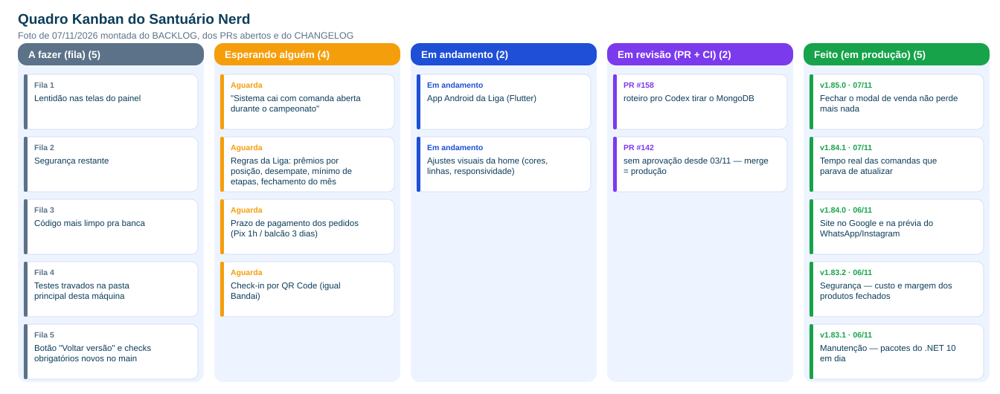

# Quadro Kanban

> Foto de 07/11/2026 montada por `scripts/gerar-metricas-agil.py` com o `docs/planejamento/BACKLOG.md`, os PRs abertos e o CHANGELOG.

## Colunas e como o fluxo real do projeto se encaixa

| Coluna | O que significa | Onde isso vive hoje |
|---|---|---|
| **A fazer (fila)** | priorizado, ainda não começou | seção "Na fila" do `BACKLOG.md` |
| **Esperando alguém** | travado numa decisão ou insumo de fora (cliente, chave, print) | seção "Esperando alguém" |
| **Em andamento** | alguém está trabalhando | seção "Em andamento" e a branch do trabalho |
| **Em revisão (PR + CI)** | PR aberto: testes, Postgres real, carga, imagens Docker, CodeQL, mapa do sistema | pull request no GitHub |
| **Feito (em produção)** | mergeado; o deploy abre sozinho e espera a aprovação do dono, com backup antes e troca sem queda | `CHANGELOG.md` |

## Políticas explícitas

- **Definição de pronto:** PR com CI verde, `CHANGELOG.md` e `BACKLOG.md` atualizados, mapa do sistema regenerado, teste em tela quando há mudança visual e aprovação do deploy pelo dono.
- **Sem push direto na `main`:** todo trabalho vira branch → PR → merge.
- **Mudança grande entra com volta:** atrás de chave de funcionalidade, com o jeito antigo guardado, para reverter sem deploy.
- **Limite de trabalho em andamento (proposta):** no máximo 3 itens em desenvolvimento ao mesmo tempo, para manter o tempo de ciclo baixo. *(Hoje é prática informal; formalizar aqui.)*

## Fluxo ao longo do tempo

- Tempo de ciclo mediano: **12 min** (p90: 5,6 h). Vazão média: **4.1 PRs/semana**.
- Gráficos em [`metricas.md`](metricas.md).
