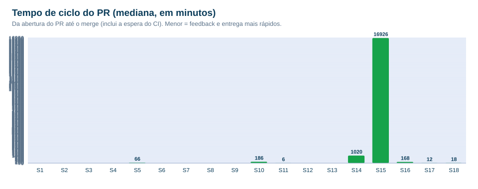
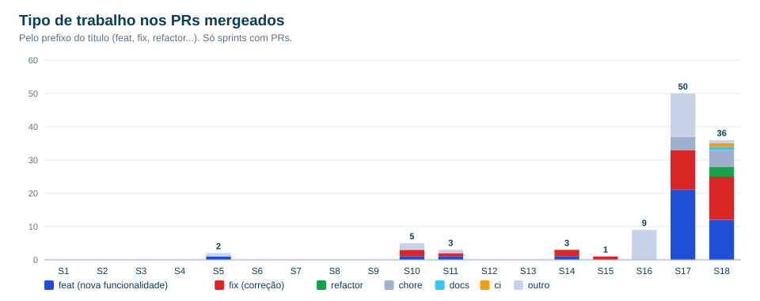

# Métricas de fluxo

> Geradas por `scripts/gerar-metricas-agil.py` a partir do CHANGELOG, do Git e do GitHub. Nada aqui foi digitado à mão.

| Métrica | Valor | O que significa |
|---|---|---|
| Versões lançadas | **157** | entregas ao cliente desde v1.0.0 |
| Commits | **877** | desde 27/03/2026 |
| PRs de desenvolvimento mergeados | **109** | fluxo com pull request, CI e revisão (desde 04/05) |
| Vazão média | **4.1 PRs/semana** | PRs mergeados por semana desde o início do fluxo |
| Tempo de ciclo — mediana | **12 min** | da abertura do PR ao merge (inclui a espera do CI) |
| Tempo de ciclo — média | **6,3 h** | puxada por poucos PRs que ficaram abertos mais tempo |
| Tempo de ciclo — percentil 90 | **5,6 h** | 9 em cada 10 PRs fecham em até isso |
| Linhas nos PRs (+ / −) | **+46.995 / −31.590** | volume de mudança; as remoções mostram a limpeza de código |
| Versões ligadas ao cliente | **33** | citam pedido, relato ou teste do Maikon |
| Mudanças "com volta" | **16** | entregues atrás de chave de funcionalidade, com o jeito antigo guardado |

## O que os números mostram

- **Entrega contínua e pequena:** a mediana de poucos minutos por PR (a maior parte é a espera do CI) indica mudanças pequenas e revisadas rápido, em vez de grandes pacotes.
- **Cliente no circuito:** uma parte relevante das versões nasce de pedido ou relato direto do dono da loja, o que é o ciclo de feedback do ágil na prática.
- **Risco controlado:** a partir da sprint 16, mudanças grandes passam a entrar como "com volta" (chave de funcionalidade), permitindo reverter sem novo deploy.
- **Dívida técnica paga:** as sprints 17–18 removem código (NFC-e, WhatsApp automático, "jeito antigo" guardado) e reorganizam o back em camadas.
