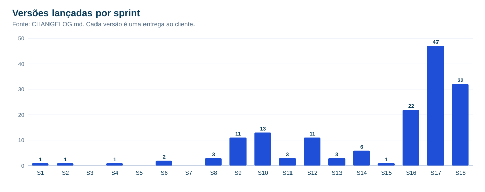
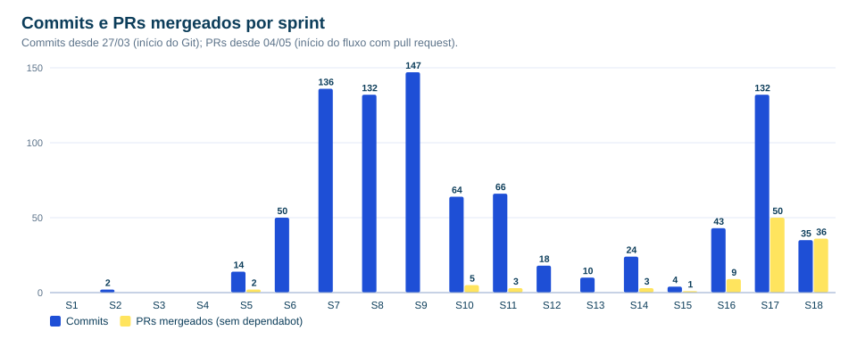
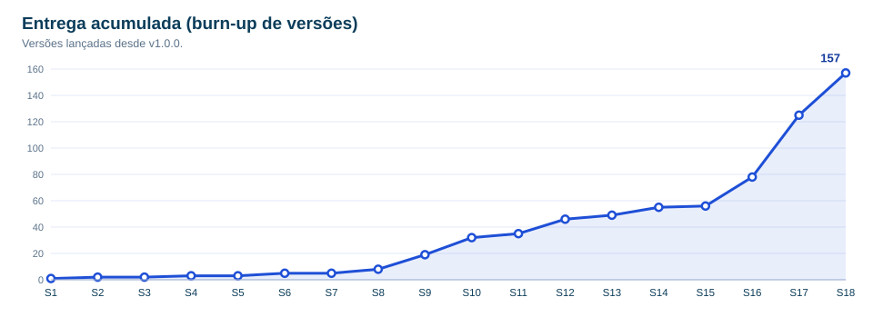
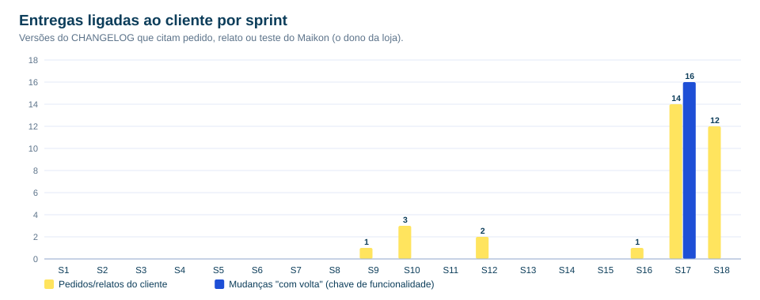

# Sprints — reconstrução retroativa

> **Como ler:** o projeto não rodava cerimônias de Scrum formais; o trabalho fluía em entregas contínuas ao cliente. Estas sprints são **janelas fixas de 14 dias** a partir da primeira versão (01/03/2026), montadas depois, a partir do histórico. **Datas, versões, commits e PRs são reais**; a *meta* de cada sprint é um resumo do que foi efetivamente entregue.

Dados de commits só existem a partir de 27/03 (início do Git) e de PRs a partir de 04/05; antes disso a coluna fica em branco (—).

| Sprint | Período | Meta (resumo do que foi entregue) | Versões | Commits | PRs | Pedidos do cliente | "Com volta" |
|:-:|---|---|:-:|:-:|:-:|:-:|:-:|
| 1 | 01/03–14/03 | Lançamento inicial do sistema de gestão (v1.0.0). | 1 | — | — | 0 | 0 |
| 2 | 15/03–28/03 | Catálogo de cartas TCG com busca integrada a API externa. | 1 | 2 | — | 0 | 0 |
| 3 | 29/03–11/04 | Sem versão publicada (consolidação). | 0 | 0 | — | 0 | 0 |
| 4 | 12/04–25/04 | Frente de Caixa (venda avulsa) com várias formas de pagamento. | 1 | 0 | — | 0 | 0 |
| 5 | 26/04–09/05 | Sem versão publicada (consolidação). | 0 | 14 | 2 | 0 | 0 |
| 6 | 10/05–23/05 | Relatório de estoque em PDF e pré-inscrição de campeonatos pela landing page. | 2 | 50 | 0 | 0 | 0 |
| 7 | 24/05–06/06 | Sem versão publicada (consolidação). | 0 | 136 | 0 | 0 | 0 |
| 8 | 07/06–20/06 | Perfis de acesso da equipe, histórico do cliente e página "Sobre o sistema" com versionamento. | 3 | 132 | 0 | 0 | 0 |
| 9 | 21/06–04/07 | Preferências por perfil, atalhos de teclado, filtros de cartas, chave oficial do Pokémon TCG e **pré-vendas/reservas**. | 11 | 147 | 0 | 1 | 0 |
| 10 | 05/07–18/07 | **Pix** na comanda e na inscrição de campeonato, mensageria, desconto em R$, personalização do site e módulo fiscal (removido depois). | 13 | 64 | 5 | 3 | 0 |
| 11 | 19/07–01/08 | Domínio próprio **santuarionerd.com.br** e correções do financeiro e da nota fiscal. | 3 | 66 | 3 | 0 | 0 |
| 12 | 02/08–15/08 | Pré-venda manual com vários itens, **estorno** de venda e comanda, parcelamento e desconto Pix na página do produto. | 11 | 18 | 0 | 2 | 0 |
| 13 | 16/08–29/08 | Correções da área do cliente e forma de pagamento no histórico de compras. | 3 | 10 | 0 | 0 | 0 |
| 14 | 30/08–12/09 | Vaga segurada na inscrição, conferência de decks e proteção da venda em andamento no caixa. | 6 | 24 | 3 | 0 | 0 |
| 15 | 13/09–26/09 | Prazo de pagamento da inscrição editável na tela. | 1 | 4 | 1 | 0 | 0 |
| 16 | 27/09–10/10 | **Crediário completo** (itens por compra, aviso de vencimento, link Pix, pagamento parcial), 1ª fase da **Liguinha** e as **"mudanças com volta"**. | 22 | 43 | 9 | 1 | 0 |
| 17 | 11/10–24/10 | **Liguinha completa** (telão, Central, "estou pronto"), redesenho da loja e do painel, **Vigia do sistema**, Pokémon preferido e API no **.NET 10**. | 47 | 132 | 50 | 14 | 16 |
| 18 | 25/10–07/11 | **Limpeza e arquitetura** (NFC-e e WhatsApp fora, Clean Architecture), correções pedidas pelo cliente, SEO, segurança e o **app Android da Liga**. | 32 | 35 | 36 | 12 | 0 |
| **19** | **08/11–21/11** | **(em andamento) Fechar o PIM IV: app, banco, documentação e iPhone — entrega em 14/11** | — | — | — | — | — |

## Totais

- **157 versões** lançadas em 18 sprints; **877 commits** desde 27/03; **109 PRs** de desenvolvimento mergeados (mais 3 de atualização automática de dependências).
- **33 versões** citam pedido, relato ou teste do dono da loja; **16** foram entregues como "mudança com volta".
- Ritmo: de 1 versão por quinzena (sprints 1–5) a **47 versões** na sprint 17 e **32** na sprint 18.

## Gráficos

## Sprint 19 — Sprint Backlog (plano até 14/11)

Situação conferida em 07/11/2026 (fim da sprint 18). Os itens 1 a 4 foram adiantados ainda na sprint 18; os demais seguem até a entrega do PIM IV em 14/11.

| # | Item | Etapa do PIM | Situação | Observação |
|:-:|---|---|:-:|---|
| 1 | App Android da Liga em Flutter (login, torneios, mesa, ranking) | 5 — Mobile | ✅ adiantado (07/11) | PR #159; testado em aparelho real |
| 2 | Identidade visual do app (fonte, cores, logo, Pokémon como foto) | 5 — Mobile | ✅ adiantado (07/11) | PR #160 |
| 3 | MER, modelo lógico, dicionário de dados e script físico | 7 — Banco | ✅ adiantado (07/11) | gerados do schema real |
| 4 | Sprints, Kanban e métricas retroativos (este pacote) | 9 — Ágil | ✅ adiantado (07/11) | gerados do histórico |
| 5 | Procedures e triggers no PostgreSQL | 7 — Banco | ⏳ a fazer | idempotentes no `postgres.sql`; testar no Postgres real |
| 6 | App para iPhone: Flutter Web (PWA) + build iOS no CI | 5 — Mobile | ⏳ a fazer | depende de aprovação de hospedagem no site |
| 7 | Tempo real por SignalR no app (hoje consulta a cada 8 s) | 5 — Mobile | ⏳ a fazer | |
| 8 | APK de release assinado + página "Baixar o app" | 5 — Mobile | ⏳ a fazer | |
| 9 | Diagramas de arquitetura (camadas e classes da Liga) | 6 — Arquitetura | ⏳ a fazer | gerar do código |
| 10 | Trabalho escrito em ABNT (etapas 1, 2, 3, 6, 8) | Escrito | ⏳ a fazer | texto autoral do grupo |
| 11 | Retirada do MongoDB (roteiro em `docs/planejamento/MONGO-FORA.md`) | 7 — Banco | 🔁 fora do caminho crítico | migra vendas do PDV; só entra se validada até 11/11 |
