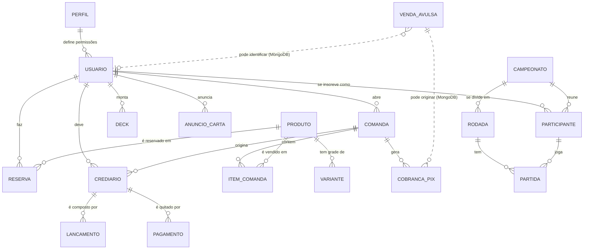
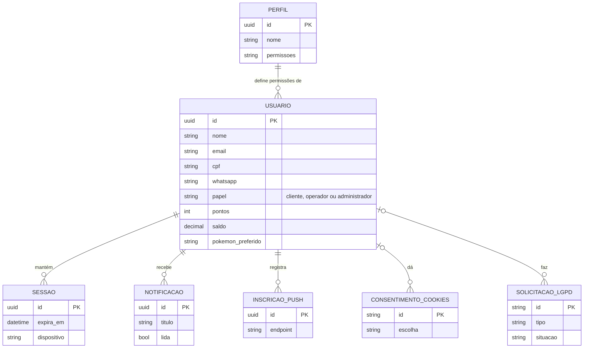
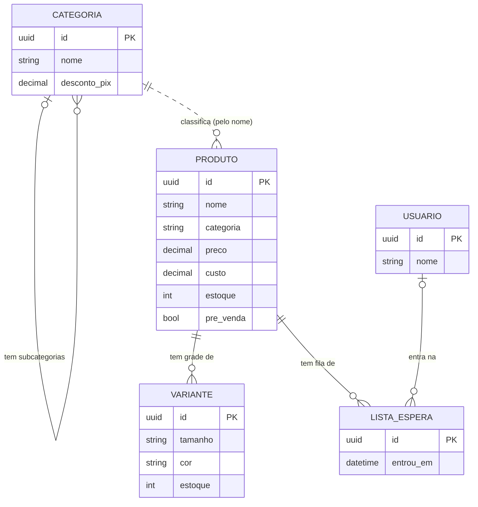
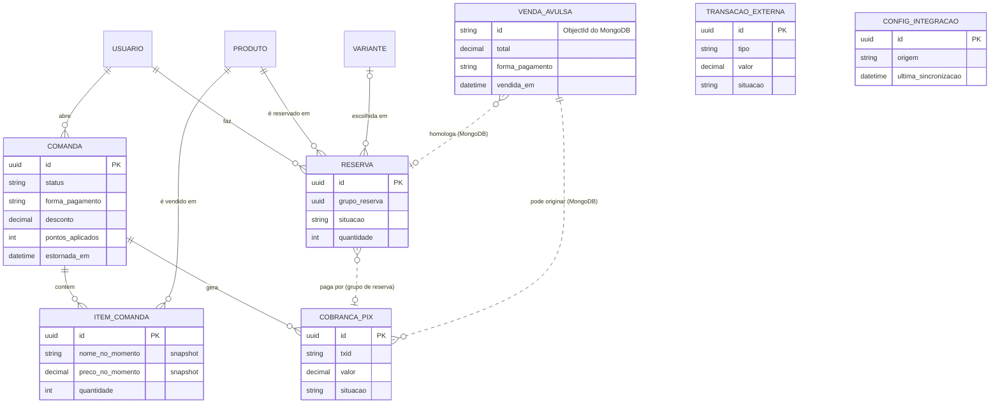
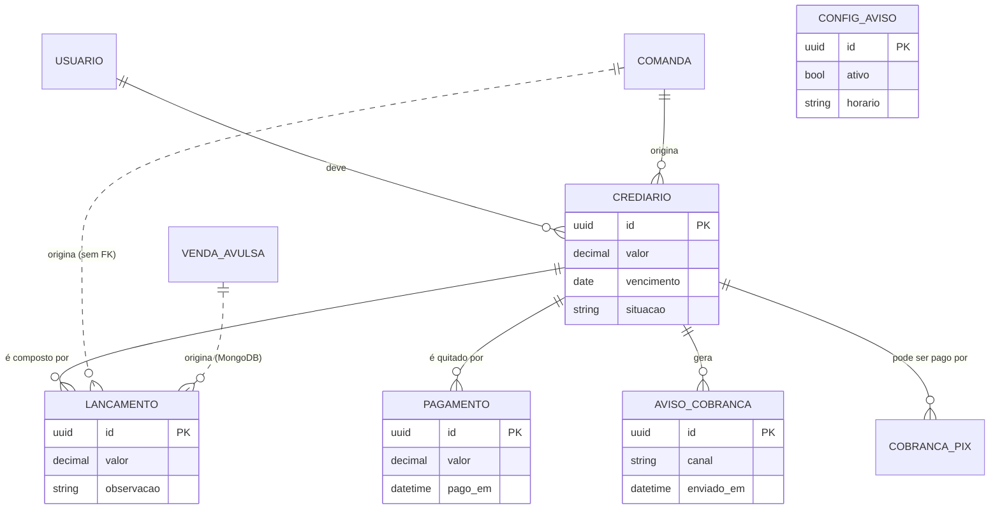
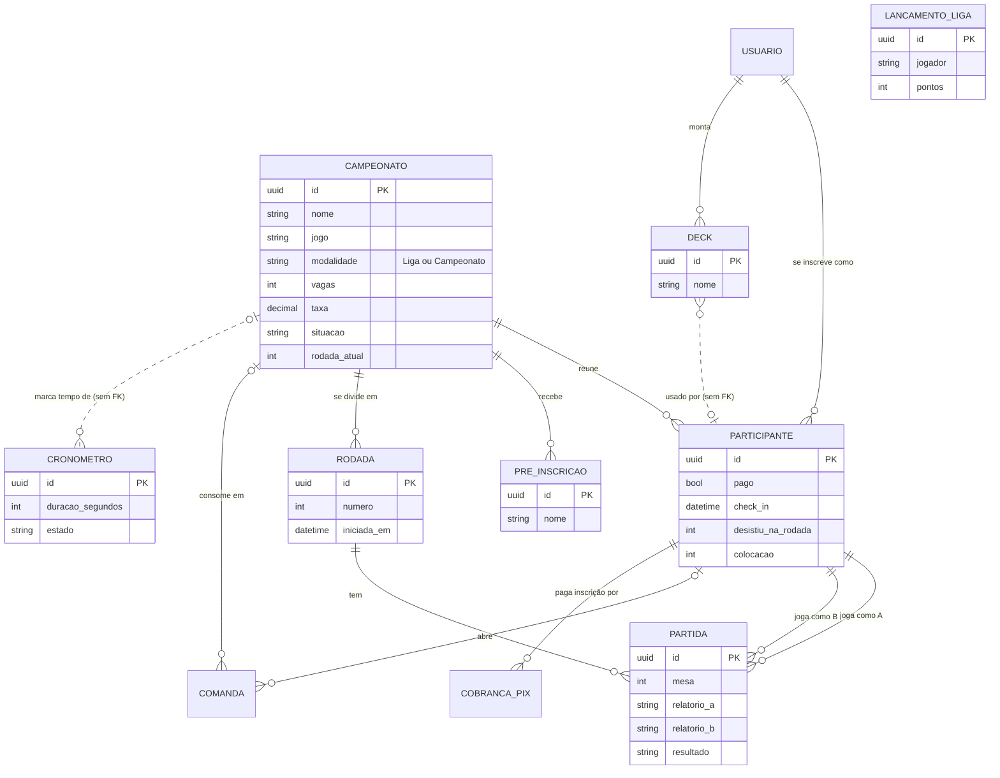
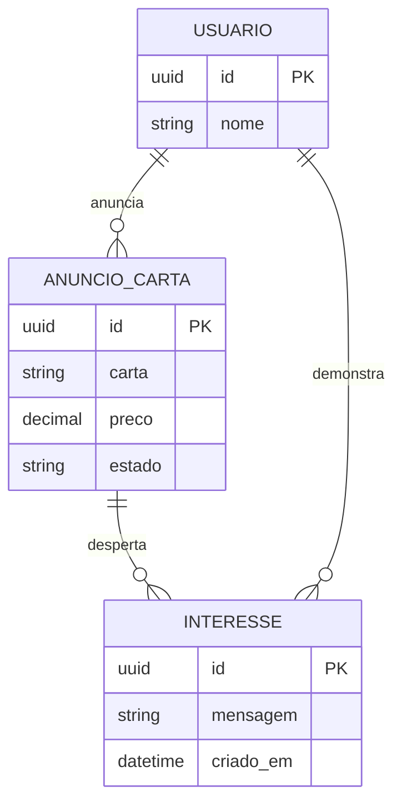
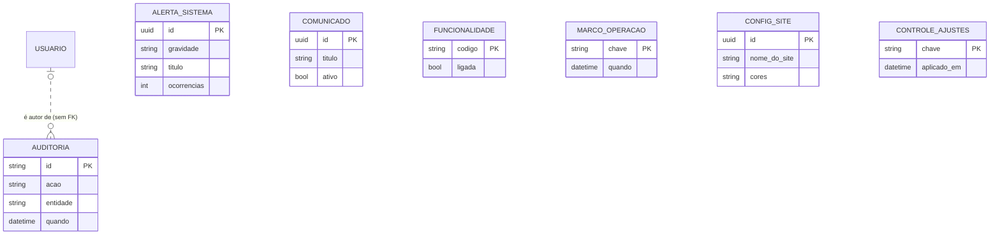

# MER conceitual — Santuário Nerd

> Gerado/atualizado por `scripts/gerar-modelo-dados.py`. Os diagramas abaixo aparecem direto no GitHub (Mermaid); as imagens prontas pro trabalho escrito estão em `img/` (SVG e PNG).

O MER conceitual descreve o **negócio**: as entidades que a loja reconhece (comanda, produto, crediário, campeonato...) e como se relacionam, sem se prender a nomes de tabela ou tipos de coluna. O modelo lógico (próximo documento) desce ao nível das tabelas.

## Como ler

| Notação | Significado |
|---|---|
| `||--o{` | um para muitos (obrigatório de um lado, opcional do outro) |
| `|o--o{` | um (opcional) para muitos |
| `}o..o|`, `||..o{` (linha **tracejada**) | relação que existe no sistema mas **sem chave estrangeira no banco** (a aplicação garante), ou que aponta pro MongoDB |
| `PK` | identificador da entidade |

## Visão geral

## Acesso e identidade

Quem usa o sistema: clientes, equipe, perfis de permissão, sessões, avisos ao usuário e LGPD.

## Catálogo e estoque

O que a loja vende: categorias (com subcategorias), produtos, variações de tamanho/cor e lista de espera.

## Comanda, reservas e pagamentos

Venda na mesa (comanda), pré-venda/reserva do site, cobranças Pix e integração bancária.

## Crediário

Contas a receber do cliente: dívida, lançamentos, pagamentos parciais e avisos de cobrança.

## Campeonatos, Liga e torneios

Campeonatos e Liga mensal, inscritos, rodadas e partidas do torneio suíço, decks e cronômetros.

## Mercado de cartas

Anúncios de cartas entre jogadores e os interessados em cada anúncio.

## Sistema e operação

Auditoria, alertas do Vigia, comunicados, chaves de funcionalidade, configuração do site e marcos de operação.

## Entidades que vivem fora do PostgreSQL

`VENDA_AVULSA` (venda feita no caixa/PDV e as geradas ao homologar pedidos do site) fica no **MongoDB**, na coleção `vendas_avulsas`, como documento autocontido: itens, total, forma de pagamento, desconto, cliente e estorno ficam **copiados** no momento da venda (nome e preço do produto não mudam se o cadastro mudar depois). Outras tabelas apontam pra ela por um identificador em texto (`venda_avulsa_id` em `crediario_lancamentos`, `product_reservations` e `pix_cobrancas`), por isso aparecem tracejadas. O Mongo também guarda o cache de cartas das APIs de TCG.
