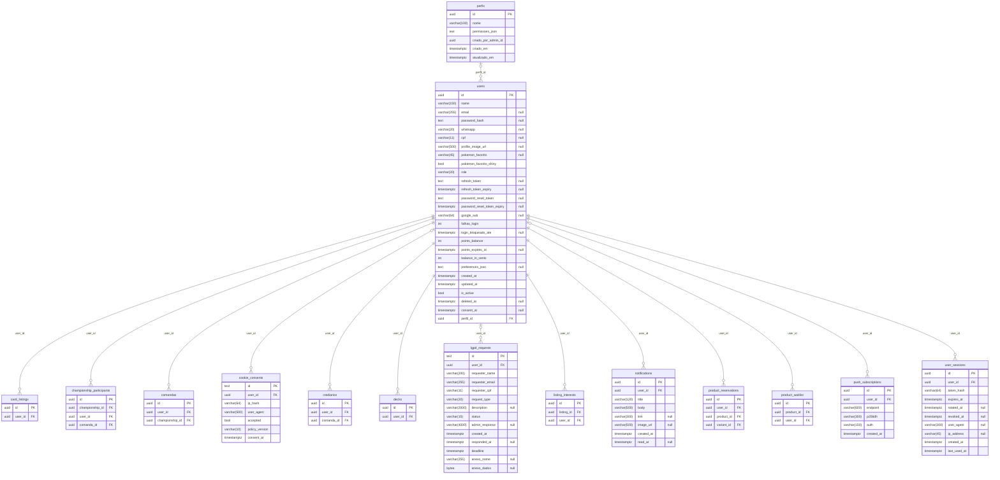
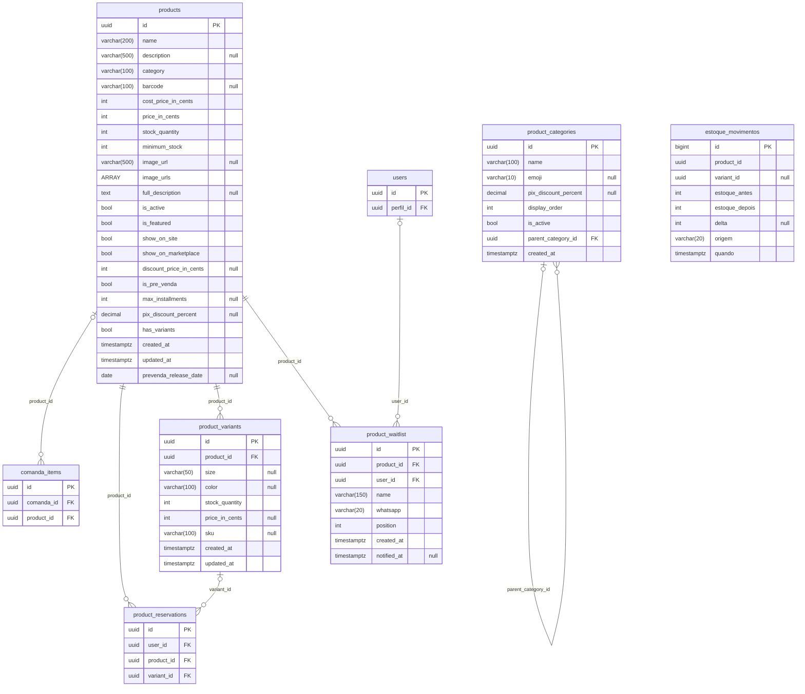
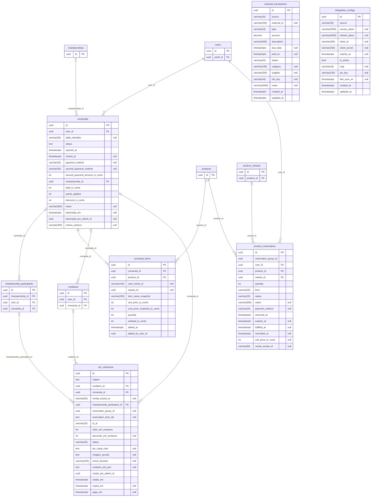
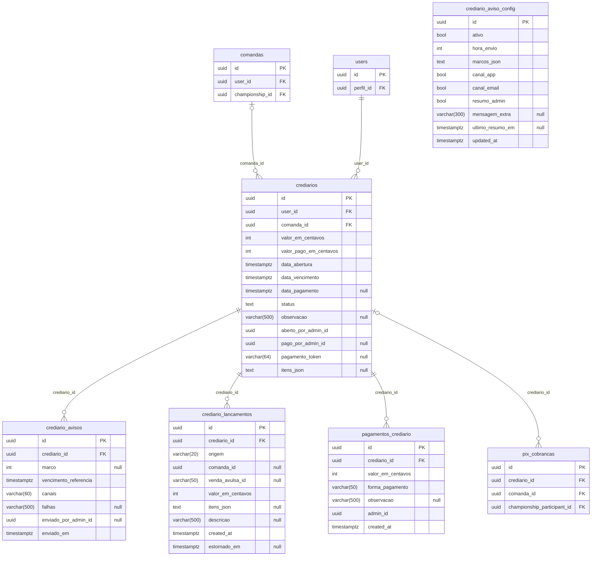
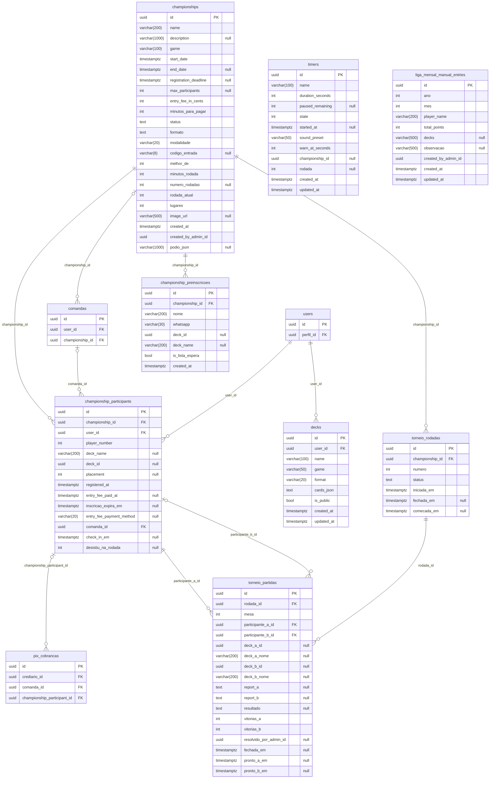
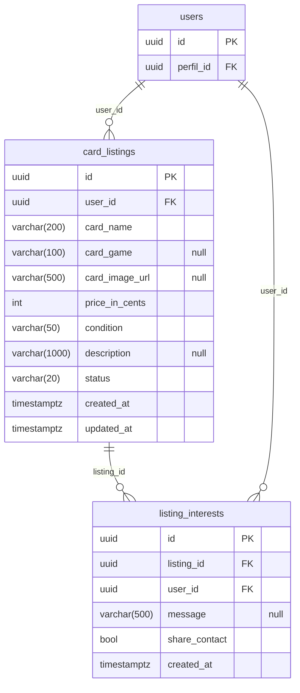
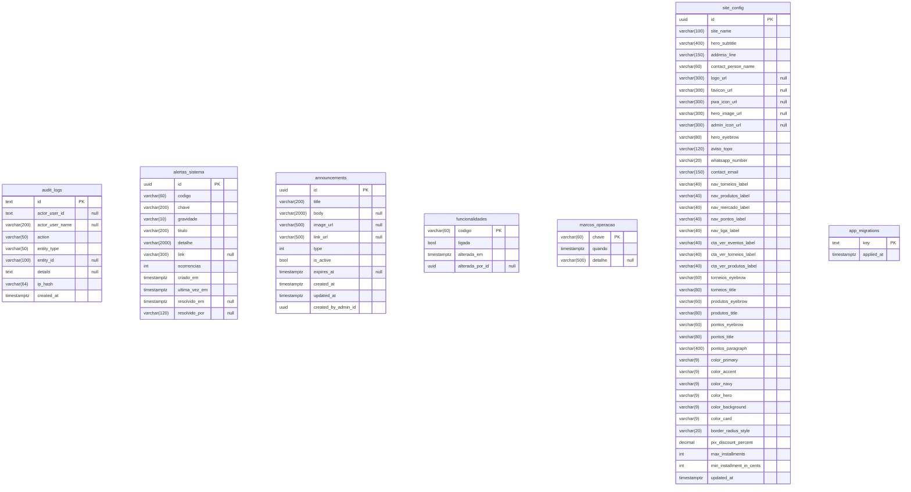

# Modelo lógico — Santuário Nerd (PostgreSQL)

> **Gerado do banco real** por `scripts/gerar-modelo-dados.py`. Não é desenho à mão: se o schema mudar, rode o script de novo.

**40 tabelas · 476 colunas · 40 chaves primárias · 37 chaves estrangeiras · 126 índices** (banco PostgreSQL 16).

Legenda: `PK` chave primária, `FK` chave estrangeira, `UK` valor único; `"null"` = coluna aceita nulo. Tabelas com sufixo *(ref.)* aparecem só pra mostrar a relação com outro domínio (só as chaves).

## Mapa do banco inteiro

```mermaid
erDiagram
  users ||--o{ card_listings : "user_id"
  championships ||--o{ championship_participants : "championship_id"
  comandas |o--o{ championship_participants : "comanda_id"
  users ||--o{ championship_participants : "user_id"
  championships ||--o{ championship_preinscricoes : "championship_id"
  comandas ||--o{ comanda_items : "comanda_id"
  products |o--o{ comanda_items : "product_id"
  championships |o--o{ comandas : "championship_id"
  users ||--o{ comandas : "user_id"
  users |o--o{ cookie_consents : "user_id"
  crediarios ||--o{ crediario_avisos : "crediario_id"
  crediarios ||--o{ crediario_lancamentos : "crediario_id"
  comandas |o--o{ crediarios : "comanda_id"
  users ||--o{ crediarios : "user_id"
  users ||--o{ decks : "user_id"
  users |o--o{ lgpd_requests : "user_id"
  card_listings ||--o{ listing_interests : "listing_id"
  users ||--o{ listing_interests : "user_id"
  users ||--o{ notifications : "user_id"
  crediarios ||--o{ pagamentos_crediario : "crediario_id"
  championship_participants |o--o{ pix_cobrancas : "championship_participant_id"
  comandas |o--o{ pix_cobrancas : "comanda_id"
  crediarios |o--o{ pix_cobrancas : "crediario_id"
  product_categories |o--o{ product_categories : "parent_category_id"
  product_variants |o--o{ product_reservations : "variant_id"
  products ||--o{ product_reservations : "product_id"
  users ||--o{ product_reservations : "user_id"
  products ||--o{ product_variants : "product_id"
  products ||--o{ product_waitlist : "product_id"
  users |o--o{ product_waitlist : "user_id"
  users ||--o{ push_subscriptions : "user_id"
  championship_participants ||--o{ torneio_partidas : "participante_a_id"
  championship_participants |o--o{ torneio_partidas : "participante_b_id"
  torneio_rodadas ||--o{ torneio_partidas : "rodada_id"
  championships ||--o{ torneio_rodadas : "championship_id"
  users ||--o{ user_sessions : "user_id"
  perfis |o--o{ users : "perfil_id"
  alertas_sistema {
    uuid id PK
  }
  announcements {
    uuid id PK
  }
  app_migrations {
    text key PK
  }
  audit_logs {
    text id PK
  }
  card_listings {
    uuid id PK
    uuid user_id FK
  }
  championship_participants {
    uuid id PK
    uuid championship_id FK
    uuid user_id FK
    uuid comanda_id FK
  }
  championship_preinscricoes {
    uuid id PK
    uuid championship_id FK
  }
  championships {
    uuid id PK
  }
  comanda_items {
    uuid id PK
    uuid comanda_id FK
    uuid product_id FK
  }
  comandas {
    uuid id PK
    uuid user_id FK
    uuid championship_id FK
  }
  cookie_consents {
    text id PK
    uuid user_id FK
  }
  crediario_aviso_config {
    uuid id PK
  }
  crediario_avisos {
    uuid id PK
    uuid crediario_id FK
  }
  crediario_lancamentos {
    uuid id PK
    uuid crediario_id FK
  }
  crediarios {
    uuid id PK
    uuid user_id FK
    uuid comanda_id FK
  }
  decks {
    uuid id PK
    uuid user_id FK
  }
  estoque_movimentos {
    bigint id PK
  }
  external_transactions {
    uuid id PK
  }
  funcionalidades {
    varchar(60) codigo PK
  }
  integration_configs {
    uuid id PK
  }
  lgpd_requests {
    text id PK
    uuid user_id FK
  }
  liga_mensal_manual_entries {
    uuid id PK
  }
  listing_interests {
    uuid id PK
    uuid listing_id FK
    uuid user_id FK
  }
  marcos_operacao {
    varchar(60) chave PK
  }
  notifications {
    uuid id PK
    uuid user_id FK
  }
  pagamentos_crediario {
    uuid id PK
    uuid crediario_id FK
  }
  perfis {
    uuid id PK
  }
  pix_cobrancas {
    uuid id PK
    uuid crediario_id FK
    uuid comanda_id FK
    uuid championship_participant_id FK
  }
  product_categories {
    uuid id PK
    uuid parent_category_id FK
  }
  product_reservations {
    uuid id PK
    uuid user_id FK
    uuid product_id FK
    uuid variant_id FK
  }
  product_variants {
    uuid id PK
    uuid product_id FK
  }
  product_waitlist {
    uuid id PK
    uuid product_id FK
    uuid user_id FK
  }
  products {
    uuid id PK
  }
  push_subscriptions {
    uuid id PK
    uuid user_id FK
  }
  site_config {
    uuid id PK
  }
  timers {
    uuid id PK
  }
  torneio_partidas {
    uuid id PK
    uuid rodada_id FK
    uuid participante_a_id FK
    uuid participante_b_id FK
  }
  torneio_rodadas {
    uuid id PK
    uuid championship_id FK
  }
  user_sessions {
    uuid id PK
    uuid user_id FK
  }
  users {
    uuid id PK
    uuid perfil_id FK
  }
```

## Acesso e identidade

Quem usa o sistema: clientes, equipe, perfis de permissão, sessões, avisos ao usuário e LGPD.

## Catálogo e estoque

O que a loja vende: categorias (com subcategorias), produtos, variações de tamanho/cor, lista de espera e o histórico de mudanças de estoque (gravado por trigger).

## Comanda, reservas e pagamentos

Venda na mesa (comanda), pré-venda/reserva do site, cobranças Pix e integração bancária.

## Crediário

Contas a receber do cliente: dívida, lançamentos, pagamentos parciais e avisos de cobrança.

## Campeonatos, Liga e torneios

Campeonatos e Liga mensal, inscritos, rodadas e partidas do torneio suíço, decks e cronômetros.

## Mercado de cartas

Anúncios de cartas entre jogadores e os interessados em cada anúncio.

## Sistema e operação

Auditoria, alertas do Vigia, comunicados, chaves de funcionalidade, configuração do site e marcos de operação.

## Decisões de modelagem

- **Chaves `uuid`** geradas pela aplicação (`Guid`) na maioria das tabelas; algumas tabelas de controle usam texto (`audit_logs`, `cookie_consents`, `lgpd_requests`) ou um código natural (`funcionalidades.codigo`, `marcos_operacao.chave`, `app_migrations.key`).
- **Snapshot em vez de junção para histórico:** `comanda_items` guarda o nome e o preço do item no momento da venda; mudar o cadastro do produto depois não altera a comanda antiga nem o financeiro.
- **Estorno em vez de exclusão:** venda não se apaga; é marcada como estornada (data, quem estornou e motivo) e sai das contas, mas continua no extrato.
- **Datas em `timestamptz` (UTC)**; o "dia" do negócio é calculado no calendário de Brasília na aplicação.
- **Sem migrations tradicionais:** o banco nasce do EF Core e de `CardGameStore/Data/Inicializacao/postgres.sql`, que roda a cada partida e precisa ser **idempotente** (`IF NOT EXISTS`, `ADD COLUMN IF NOT EXISTS`). A tabela `app_migrations` marca ajustes de dados que devem rodar uma vez só.
- **Regra de exclusão:** `CASCADE` onde o filho não faz sentido sem o pai (itens de comanda, lançamentos de crediário, partidas de uma rodada); `RESTRICT` onde apagar esconderia dinheiro (usuário com comanda ou crediário); `SET NULL` onde a referência é opcional (cliente que pediu anonimização).

## Relações lógicas sem chave estrangeira

O banco declara **37 chaves estrangeiras**. Além delas, há **33 colunas de referência** que a aplicação respeita mas o banco não força (foram mantidas assim de propósito ou por histórico):

| Coluna | Tipo | Aponta para (na prática) |
|---|---|---|
| `announcements.created_by_admin_id` | uuid | `users.id` (quem fez a ação; id guardado como histórico) |
| `audit_logs.actor_user_id` | text, nulo | `users.id` (autor da ação) |
| `audit_logs.entity_id` | varchar(100), nulo | qualquer entidade auditada |
| `championship_participants.deck_id` | uuid, nulo | `decks.id` |
| `championship_preinscricoes.deck_id` | uuid, nulo | `decks.id` |
| `championships.created_by_admin_id` | uuid | `users.id` (quem fez a ação; id guardado como histórico) |
| `comanda_items.card_cache_id` | varchar(100), nulo | carta no cache do MongoDB |
| `comanda_items.variant_id` | uuid, nulo | `product_variants.id` |
| `comanda_items.added_by_user_id` | uuid | `users.id` (quem fez a ação; id guardado como histórico) |
| `comandas.estornada_por_admin_id` | uuid, nulo | `users.id` (quem fez a ação; id guardado como histórico) |
| `crediario_avisos.enviado_por_admin_id` | uuid, nulo | `users.id` (quem fez a ação; id guardado como histórico) |
| `crediario_lancamentos.comanda_id` | uuid, nulo | `comandas.id` |
| `crediario_lancamentos.venda_avulsa_id` | varchar(50), nulo | venda do PDV (MongoDB `vendas_avulsas`) |
| `crediarios.aberto_por_admin_id` | uuid | `users.id` (quem fez a ação; id guardado como histórico) |
| `crediarios.pago_por_admin_id` | uuid, nulo | `users.id` (quem fez a ação; id guardado como histórico) |
| `estoque_movimentos.product_id` | uuid | `products.id` (sem FK de propósito: o histórico sobrevive à exclusão do produto) |
| `estoque_movimentos.variant_id` | uuid, nulo | `product_variants.id` |
| `external_transactions.external_id` | varchar(200), nulo | identificador no sistema externo (banco) |
| `funcionalidades.alterada_por_id` | uuid, nulo | `users.id` (quem fez a ação; id guardado como histórico) |
| `integration_configs.client_id` | varchar(200), nulo | credencial da integração |
| `liga_mensal_manual_entries.created_by_admin_id` | uuid | `users.id` (quem fez a ação; id guardado como histórico) |
| `pagamentos_crediario.admin_id` | uuid | `users.id` (quem fez a ação; id guardado como histórico) |
| `perfis.criado_por_admin_id` | uuid | `users.id` (quem fez a ação; id guardado como histórico) |
| `pix_cobrancas.venda_avulsa_id` | varchar(50), nulo | venda do PDV (MongoDB `vendas_avulsas`) |
| `pix_cobrancas.reservation_group_id` | uuid, nulo | grupo de reserva (carrinho) — sem tabela própria |
| `pix_cobrancas.tx_id` | varchar(35) | txid do Pix no banco |
| `pix_cobrancas.criado_por_admin_id` | uuid | `users.id` (quem fez a ação; id guardado como histórico) |
| `product_reservations.reservation_group_id` | uuid | grupo de reserva (carrinho) — sem tabela própria |
| `product_reservations.venda_avulsa_id` | varchar(80), nulo | venda do PDV (MongoDB `vendas_avulsas`) |
| `timers.championship_id` | uuid, nulo | `championships.id` |
| `torneio_partidas.deck_a_id` | uuid, nulo | `decks.id` |
| `torneio_partidas.deck_b_id` | uuid, nulo | `decks.id` |
| `torneio_partidas.resolvido_por_admin_id` | uuid, nulo | `users.id` (quem fez a ação; id guardado como histórico) |

> Possível evolução: transformar as referências para `users`, `decks`, `product_variants` e `comandas` em chaves estrangeiras (com `ON DELETE SET NULL`/`RESTRICT`), depois de limpar eventuais órfãos. Foi deixado de fora para não arriscar o banco em produção.
